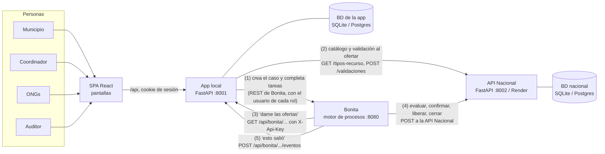
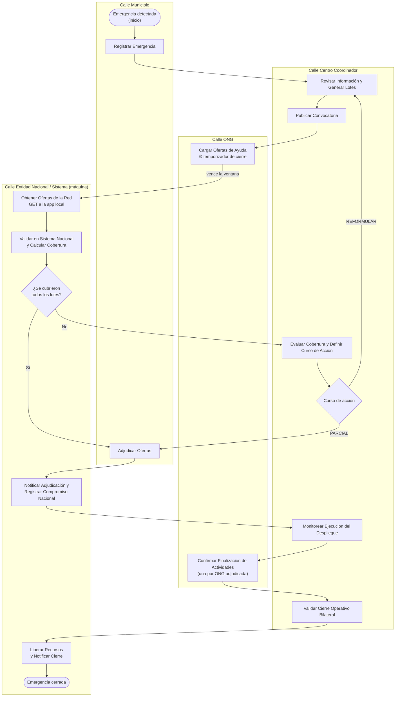
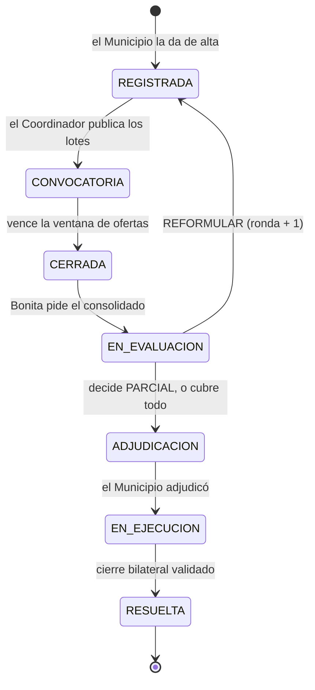
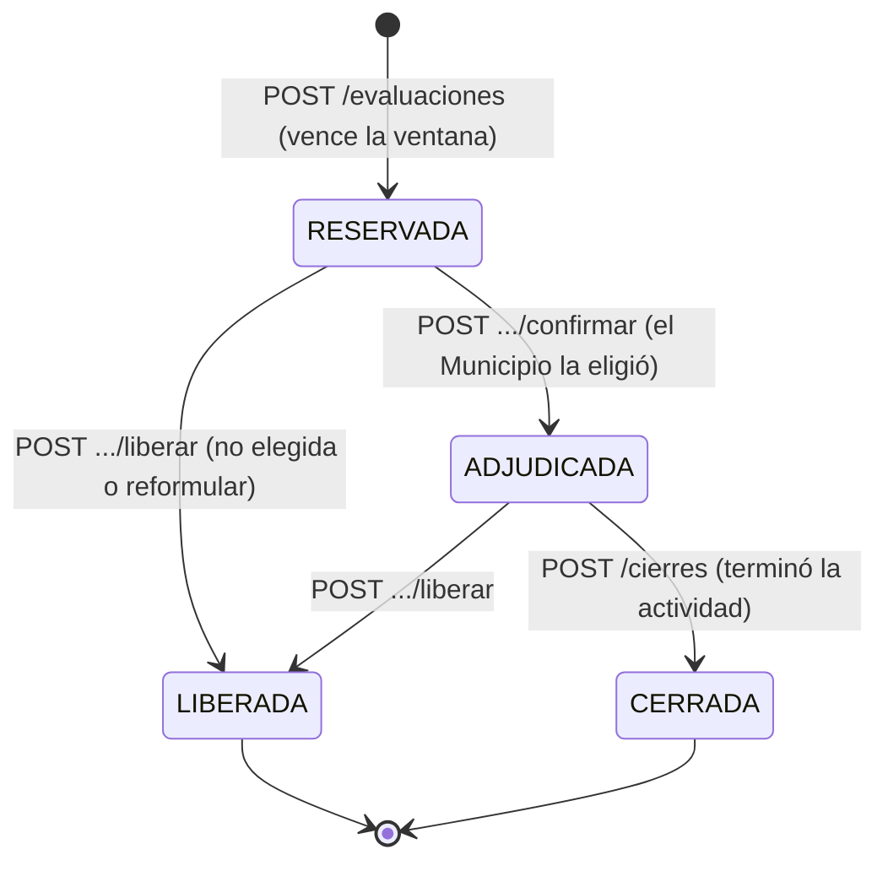
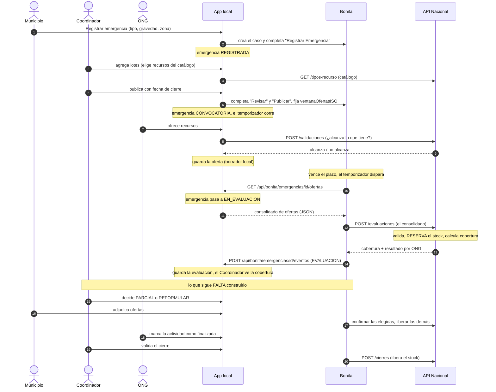
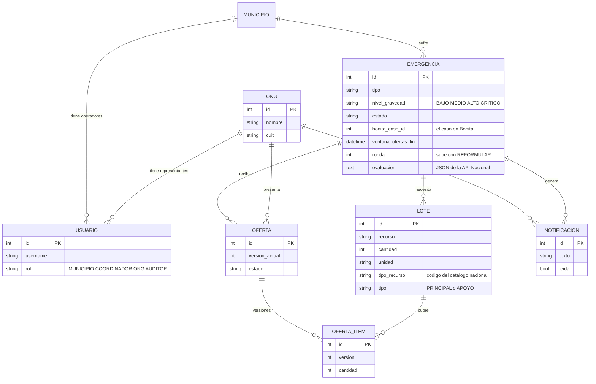
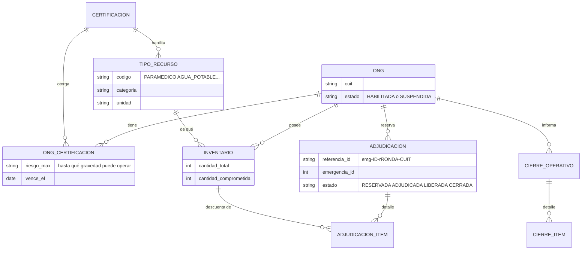

# RescueSync: cómo funciona el sistema (guía para entenderlo desde cero)

Estado del sistema: **17/10/2026**, rama `modelado-tomas-e-3`. Entrega 3 el 22/10/2026.

> **Para la IA que lea esto (otro chat):** explicale el sistema a una persona que **no prestó atención al principio**
> y no conoce Bonita. Usá analogías simples, andá de lo general a lo particular, y repetí el mapa de los tres sistemas
> cada vez que haga falta. Los diagramas están en Mermaid (renderizalos o describilos). Lo que dice "HECHO" está
> programado y probado; lo que dice "FALTA" todavía no existe. Los nombres de endpoints, tablas y tareas son reales.
> Si algo de acá contradice lo que ves en el código, el código manda.

---

## 1. La idea en 30 segundos

Un municipio sufre una **emergencia** (una inundación, por ejemplo). Necesita ayuda: paramédicos, agua, ambulancias.
Un **centro coordinador** arma la lista de lo que hace falta (los **lotes**) y abre una **convocatoria** con un plazo.
Las **ONGs** ofrecen lo que tienen. Cuando el plazo vence, el sistema **valida** las ofertas, **reserva** los recursos
para que dos emergencias no se pisen el mismo stock, y el municipio **elige** a quién aceptar. Después las ONGs
trabajan, avisan que terminaron y los recursos se **liberan**.

Eso es un **proceso de negocio**, y la materia (DSSD) pide modelarlo con **Bonita BPM** (un motor de procesos) y
conectarlo con aplicaciones reales. Por eso hay tres sistemas que se hablan entre sí.

---

## 2. Los tres sistemas (el mapa)

| Sistema | Qué es | Para qué sirve | Dónde corre | Su base de datos |
|---|---|---|---|---|
| **App local** (`backend/` + `frontend/`) | Una web: API en FastAPI (Python) y una SPA en React | Es lo que usan las personas: pantallas, usuarios, emergencias, lotes y ofertas. Guarda las ofertas mientras son borradores | `localhost:8001` (API), `localhost:5173` (pantallas en desarrollo) | SQLite en desarrollo, Postgres en producción (`dev.db`) |
| **Bonita** | Un motor de procesos (producto de terceros) | Es el **director de orquesta**: sabe en qué paso está cada emergencia, quién tiene que hacer qué, cuándo vence el plazo (un temporizador) y a quién llamar | `localhost:8080/bonita` (el que trae Bonita Studio) | La suya propia (la maneja Bonita) |
| **API Nacional** (`nacional/`) | Una API REST en FastAPI, pensada para vivir en la nube | Es el "registro nacional" de recursos: catálogo, certificaciones de cada ONG, inventario, y sobre todo **reserva y libera stock** con control de concurrencia | `localhost:8002`; en la nube: `https://sistema-nacional-latest.onrender.com` (Render) | SQLite en desarrollo (`nacional.db`), Postgres en la nube |

**Analogía:** la app local es el mostrador donde atiende la gente. La API Nacional es el depósito central con el
inventario real. Bonita es el supervisor con la planilla del proceso: no atiende a nadie ni guarda stock, pero decide
el orden de las cosas y llama a los otros dos cuando toca.

### Quién le habla a quién



**Regla de oro de la consigna:** **Bonita inicia la comunicación** con el resto. Cuando vence el plazo, Bonita (no la
app) le pide las ofertas a la app, y después (no la app) se las manda a la API Nacional. La app solo llama a Bonita para
arrancar el caso y avanzar las tareas que hacen personas.

---

## 3. Las personas (roles) y qué hace cada una

| Rol | Usuario de demo | Qué hace |
|---|---|---|
| **Operador Municipal** | `operador.municipal` (y `operador.municipal2`) | Registra la emergencia. En el cierre del ciclo **adjudica**: elige entre las ofertas ya validadas |
| **Centro Coordinador Regional** | `coordinador.regional` | Arma los lotes de necesidades y **publica** la convocatoria con su fecha de cierre. Si las ofertas no alcanzan, **decide** si reformular o seguir con cobertura parcial. Monitorea la ejecución y valida el cierre |
| **Representante de ONG** | `ong.cruzroja`, `ong.bomberos` | **Ofrece** recursos, los edita o los retira mientras la ventana está abierta. Ve sus avisos. Marca sus actividades como terminadas |
| **Auditor / Directivo** | `auditor` | Solo mira |

Los mismos usuarios existen en **la app** (clave `demo1234`) y en **Bonita** (clave `bpm`), con el mismo nombre: así
Bonita registra quién hizo cada tarea. La app usa el usuario de cada persona para avanzar las tareas del motor.

---

## 4. El proceso en Bonita (el diagrama que modela la materia)

Bonita dibuja el proceso en **calles** (*lanes*): cada calle es un rol. Cada caja es una **tarea**. Una tarea es de
persona (alguien la completa) o de **servicio** (la hace una máquina: es donde Bonita llama a otros sistemas con un
**conector**). El proceso se llama *Gestion Integral de la Emergencia*.



Notas que ayudan a entenderlo:

- **El temporizador** está pegado a "Cargar Ofertas de Ayuda". Esa tarea queda abierta todo el plazo; cuando el reloj
  llega a la fecha de cierre, Bonita sigue **solo** por la flecha "vence la ventana". Nadie completa esa tarea: la app
  tiene prohibido hacerlo (si no, cerraría el plazo antes de tiempo).
- Las ofertas **no viven en Bonita**: viven en la base de la app. Bonita solo "sabe" que el plazo existe.
- Las dos compuertas (rombos) deciden el camino leyendo **variables del proceso**: `coberturaCompleta` y
  `decisionCoordinador`.
- Las variables del proceso (la "memoria" del caso): `emergenciaId`, `municipioId`, `nivelGravedad`,
  `ventanaOfertasISO`, `ofertasJson` (el consolidado de ofertas), `coberturaCompleta`, `porcentajeCobertura`,
  `decisionCoordinador`, `ongsAdjudicadas`, y `evaluacionJson` (la respuesta de la API Nacional; todavía hay que crearla).

---

## 5. Las tres vidas: emergencia, oferta y reserva

### 5.1 La emergencia (estado en la app)


HECHO hasta `EN_EVALUACION`. FALTA el resto (WP5 y WP6).

### 5.2 La oferta de una ONG

Cada oferta es **una unidad** con versiones: editarla crea una versión nueva con **todos** sus ítems (las anteriores
quedan de historial), y retirarla es enviarla vacía. Estados previstos: `PRESENTADA` → `ADJUDICADA` o `NO_ADJUDICADA` →
`FINALIZADA`.

### 5.3 La reserva de stock (estado en la API Nacional)



El stock de una ONG tiene tres números: **total**, **comprometido** y **disponible = total − comprometido**. Reservar
sube el comprometido; liberar o cerrar lo baja.

### 5.4 Cuatro fases de un recurso

| Fase | Dónde está "reservado" | Qué lo libera |
|---|---|---|
| 1. Ventana abierta (borrador) | En la app: el tope suma las ofertas de la ONG | Editar, reducir o retirar la oferta |
| 2. Ventana vencida, sin decidir | En la **API Nacional**, estado `RESERVADA` | Que el Municipio no la elija, o reformular |
| 3. Adjudicada | En la API Nacional, estado `ADJUDICADA` (compromiso firme) | El cierre de la actividad |
| 4. Cerrada | En ningún lado: el stock volvió | — |

La consigna pide que la nube **no guarde borradores**: por eso en la fase 1 las ofertas son solo locales, y recién
al vencer la ventana la reserva pasa a la API Nacional.

---

## 6. Un recorrido completo (secuencia)



Los pasos hasta "el Coordinador ve la cobertura" están **HECHOS**, salvo los dos conectores de Bonita que falta armar
en Studio (pasos 12 a 14 del diagrama: Bonita → API Nacional y Bonita → evento de la app).

---

## 7. Los datos

### 7.1 Base de la app local


La tabla `notificacion` ya existe pero **todavía no se usa** (es de WP6).

### 7.2 Base de la API Nacional



Datos de prueba (seed): **Cruz Roja** (`30-54666544-5`): certificación de salud prehospitalaria hasta riesgo MEDIO;
4 paramédicos, 2 ambulancias, 5000 raciones, 3000 L de agua, 500 frazadas. **Bomberos Voluntarios**
(`30-68522415-9`): rescate acuático hasta CRITICO, incendio forestal hasta ALTO, salud prehospitalaria **vencida**;
6 paramédicos, 12 rescatistas acuáticos, 3 botes, 20 brigadistas, 4 autobombas, 5 generadores. Una **fundación
suspendida** con 800 raciones. En total 11 tipos de recurso y 4 certificaciones.

---

## 8. Las reglas importantes

1. **Tope al ofertar (en la app).** Una ONG no puede ofrecer más de lo que tiene. Lo que ofrece de un recurso se suma
   con lo que ya ofreció en **sus otras convocatorias sin evaluar**, y se compara con el disponible de la API
   Nacional. Bajar o retirar una oferta nunca se rechaza. Si la API Nacional no responde, no se guarda la oferta.
2. **Competencia (en la API Nacional).** Cada recurso puede exigir una certificación. Según la gravedad de la emergencia
   la ONG opera con nivel **PLENA** (principal), **PARCIAL** (su certificación llega a menos gravedad: queda de
   **apoyo**) o **SUPERVISADA** (sin certificación vigente: apoyo supervisado). No se rechaza a nadie, se degrada.
3. **Reserva todo o nada.** Si lo que una ONG ofrece (sumado por recurso) no entra en su disponible, **no se reserva nada
   de esa oferta** y no se recorta: queda `NO_RESERVADA` y la ONG tiene que rehacerla. Lo que sobra de un lote se
   reserva entero (el Municipio elige y el resto se libera).
4. **Cobertura.** Por lote: `min(reservado, pedido) / pedido`. Total: **promedio simple** de los lotes. Está completa
   si todos los lotes tienen `reservado ≥ pedido`.
5. **Referencia.** Cada reserva se identifica con `emg-{emergencia}-r{ronda}-{cuit}`. Repetir una llamada con la misma
   referencia **no** reserva dos veces (idempotencia). La ronda sube si se reformula.
6. **Concurrencia.** La API Nacional bloquea las filas de inventario involucradas (`SELECT … FOR UPDATE`, en orden por
   id) antes de leer lo disponible, para que dos reservas simultáneas no se pasen del stock. Es una exigencia de la
   consigna (se prueba con Postgres; SQLite no soporta ese bloqueo).
7. **Seguridad entre Bonita y la app.** Los endpoints `/api/bonita/*` no tienen sesión: piden la cabecera `X-Api-Key`
   (clave de desarrollo `rescuesync-dev-key`). El **JWT** entre sistemas está **postergado** a propósito.

---

## 9. Los endpoints, sistema por sistema

### App local (`:8001`)
- **Personas** (`/api`, con sesión): `POST /auth/login|logout`, `GET /auth/me`, `GET /meta`; `GET|POST /emergencias`,
  `GET /emergencias/{id}` (trae la evaluación si el rol es Municipio, Coordinador o Auditor); `GET /tipos-recurso`;
  `POST|DELETE /emergencias/{id}/lotes`; `POST /emergencias/{id}/publicar`; `GET|POST /emergencias/{id}/ofertas`.
- **Bonita** (`/api/bonita`, con `X-Api-Key`): `GET /emergencias/{id}/ofertas` (el consolidado; pasa la emergencia a
  `EN_EVALUACION`) y `POST /emergencias/{id}/eventos` (tipos `EVALUACION` y `ADJUDICACION`; el tipo `CIERRE` FALTA).

### API Nacional (`:8002`, Swagger en `/docs`)
- Consulta: `GET /tipos-recurso`, `/certificaciones`, `/ongs`, `/ongs/{cuit}` (ficha con inventario),
  `/recursos/disponibilidad`, `/health`; `PUT /ongs/{cuit}/inventario`.
- Validación: `POST /validaciones` (solo responde, no guarda nada).
- **Reserva (HECHO):** `POST /evaluaciones`, `POST /adjudicaciones/{referencia}/confirmar`,
  `POST /adjudicaciones/{referencia}/liberar`.
- **Cierre (HECHO):** `POST /cierres` con `{cuit, referencia}` (libera exactamente lo que comprometió esa referencia
  `ADJUDICADA` y la pasa a `CERRADA`), `GET /cierres/{id}`, `GET /ongs/{cuit}/cierres`.
- Heredado: `POST /adjudicaciones` (compromiso directo con ids internos, de la etapa anterior).

### Bonita (lo que la app le pide)
`POST /loginservice`; instanciar el caso con el contrato (`emergenciaId`, `municipioId`, `nivelGravedad`,
`ventanaOfertasISO`); listar y completar tareas; leer y escribir variables del caso.

---

## 10. Qué está hecho y qué falta

Las tareas del plan se llaman **WP** (*work package*).

| WP | Qué | Estado |
|---|---|---|
| Entregas 1 y 2 | Modelo en Bonita; alta de emergencia, lotes, publicación, ofertas con tope, versiones, retirar | HECHO |
| WP0 | Contratos entre los tres sistemas por escrito (`entrega-3/contratos.md`) | HECHO |
| WP1 | La app entrega el consolidado a Bonita y reserva localmente hasta la evaluación | HECHO y probado con Bonita real |
| Primer conector de Bonita | "Obtener Ofertas de la Red": GET a la app | HECHO (URL fija en el conector) |
| WP2 | API Nacional: evaluar con reserva (todo o nada), confirmar, liberar | HECHO (falta probar la concurrencia en Postgres) |
| Evento `EVALUACION` | La app guarda el resultado y el Coordinador ve la cobertura | HECHO |
| WP4 (conectores de Bonita) | Evaluar y avisar a la app (HECHO); resolver las reservas y avisar la adjudicación (HECHO); falta el de cierre (`Liberar Recursos y Notificar Cierre`) | PARCIAL |
| WP3 | `POST /cierres` atado a la referencia | HECHO (tests y servidor real; falta probarlo con Bonita en la Parada 3) |
| WP5 | El Coordinador decide (parcial o reformular) y el Municipio adjudica, con el evento `ADJUDICACION` | HECHO y probado con Bonita real (Parada 2) |
| WP6 | Notificaciones, finalizar actividad, monitoreo, cierre bilateral, evento `CIERRE` | Backend HECHO y probado con Bonita real; falta la pantalla (campana y botones) |
| WP7 | Deploy final de la API Nacional en Render con Postgres | FALTA (hoy la nube corre código viejo) |
| WP8 | Docker Compose con Postgres, backend y frontend | FALTA |
| WP9 | Pruebas de punta a punta | FALTA |
| WP10 | README, guion de demo, video, prueba en una máquina limpia | FALTA |
| WP11 | JWT | POSTERGADO |
| WP12 | Bonita con parámetros por entorno, para apuntar a la nube sin editar conectores | FALTA (al final, con todo probado en local; hoy los conectores llevan `localhost` fijo) |

**Primera parada de pruebas (HECHA, 26/26):** tres usuarios ofertan, vence el plazo y, sin tocar nada, Bonita trae las
ofertas, la API Nacional reserva el stock y el Coordinador ve la cobertura en pantalla. Para eso falta, en Bonita
Studio, la tarea "Validar en Sistema Nacional y Calcular Cobertura": crear la variable `evaluacionJson`, un conector
`POST` a la API Nacional, un conector `POST` al evento de la app y dos operaciones que completan `coberturaCompleta` y
`porcentajeCobertura`.

---

## 11. Cómo se corre y se prueba

| Qué | Cómo |
|---|---|
| Bonita | Abrir Bonita Studio, desplegar la organización y el proceso (**Ejecutar**; cada vez borra los casos). Portal: `http://localhost:8080/bonita` (`walter.bates` / `bpm`) |
| API Nacional | en `nacional/`: `python -m alembic upgrade head`, `python -m app.seed`, `python -m uvicorn app.main:app --port 8002` |
| App (API) | en `backend/`: `python -m alembic upgrade head`, `python -m app.seed`, `python -m uvicorn app.main:app --port 8001` |
| App (pantallas) | en `frontend/`: `npm run dev` → `http://localhost:5173` |
| Tests | `backend/`: `pytest` (174 pasan, 2 se saltan); `nacional/`: `pytest` (88 pasan, 3 se saltan por requerir Postgres) |
| Verificar la API Nacional por HTTP | `python nacional/scripts/verificar_despliegue.py http://localhost:8002` (50 chequeos) |
| Escenario del tope con Bonita real | `python backend/scripts/escenario_tope.py` (39 chequeos, tarda unos 3 minutos) |

Para ver el temporizador conviene publicar con el cierre a 2 o 3 minutos.

---

## 12. Dónde está cada cosa en el repositorio

```
backend/app/
  models/entities.py       tablas de la app
  routers/api.py           endpoints para las personas
  routers/bonita.py        endpoints para Bonita (X-Api-Key)
  services/                lógica: emergencias, lotes, ofertas, evaluacion (consolidado y evento)
  integrations/bonita.py   cliente REST de Bonita;  nacional.py cliente de la API Nacional
  seed.py                  usuarios de demo
backend/migrations/        migraciones Alembic (0005 es la última)
frontend/src/              api.ts (llamadas) y pages.tsx (pantallas)
nacional/app/
  models.py, schemas.py    tablas y formatos de la API Nacional
  routers/                 catalogo, inventario, validacion, cierre, adjudicacion, reservas
  services/                validacion.py (competencia), reservas.py (evaluar, confirmar, liberar)
  seed.py                  ONGs, certificaciones e inventario de prueba
entrega-2/RescueSync.bos   export viejo de Bonita;  entrega-3/*.bos es el más nuevo
entrega-3/                 planes, contratos (contratos.md) y esta guía
```

---

## 13. Glosario

- **BPM / Bonita**: modelado y ejecución de procesos de negocio; Bonita es el motor.
- **Caso**: una "corrida" del proceso. Cada emergencia tiene un caso (`bonita_case_id`).
- **Lane / calle**: la franja del diagrama de un rol. **Tarea de persona**: la completa alguien. **Tarea de servicio**: la
  hace una máquina, con un conector.
- **Conector**: la pieza de Bonita que hace una llamada a otro sistema (aquí, REST: GET o POST).
- **Variable de proceso**: la memoria del caso; las compuertas la leen para decidir.
- **Temporizador (*boundary timer*)**: reloj pegado a una tarea; al vencer, el proceso sigue por otro camino.
- **Lote**: una necesidad concreta de una emergencia (10 paramédicos). **Principal** o **apoyo**.
- **Convocatoria / ventana de ofertas**: el período en que las ONGs pueden ofrecer.
- **Tope**: no ofrecer más de lo que se tiene.
- **Consolidado**: el JSON con las ofertas de una emergencia que la app le entrega a Bonita.
- **Reserva**: stock bloqueado a la espera de una decisión. **Compromiso / adjudicación**: la reserva confirmada.
- **Ronda**: cada vez que se reformula, sube; evita chocar con las referencias de la ronda anterior.
- **Referencia**: el identificador de una reserva, `emg-{emergencia}-r{ronda}-{cuit}`.
- **Idempotente**: repetir la llamada da el mismo resultado sin duplicar efectos.
- **Locking (`FOR UPDATE`)**: bloquear filas de la base mientras se decide, para que dos procesos no pisen el mismo stock.
- **Swagger**: la página `/docs` de una API, con cada endpoint documentado y probable.
- **JWT**: tipo de token de autenticación entre sistemas (postergado).
- **WP**: *work package*, una tarea del plan.

---

## 14. Parada 2 (hecha): la decisión y la adjudicación

Probada con Bonita real (`backend/scripts/escenario_adjudicacion.py`, 34/34):

- **Cobertura parcial:** el Coordinador elige "seguir con cobertura parcial", el Municipio adjudica solo a una ONG, Bonita
  confirma su reserva y libera la de la otra (`POST /adjudicaciones/resolucion`, una sola llamada) y le avisa a la app
  (evento `ADJUDICACION`): las ofertas quedan adjudicada y no adjudicada, se crean los avisos para las ONGs y la emergencia
  pasa a `EN_EJECUCION`. El caso de Bonita espera en "Monitorear Ejecución del Despliegue".
- **Reformulación:** el Coordinador elige REFORMULAR, la app libera las reservas de la ronda en la API Nacional, retira las
  ofertas (el historial queda), sube la ronda y la emergencia vuelve a registrada. Bonita vuelve a "Revisar Información"; se
  publica de nuevo, las ONGs ofrecen, la evaluación de la ronda 2 (referencia `emg-ID-r2-CUIT`) cubre todo, va directo a
  adjudicación y el Municipio adjudica.

Lo que sigue (Parada 3, el flujo completo): "Marcar actividad finalizada" de cada ONG, monitoreo y cierre bilateral del
Coordinador, el conector de "Liberar Recursos y Notificar Cierre" y el evento `CIERRE`, las notificaciones en pantalla y la
multi-instancia de "Confirmar Finalización". `POST /cierres` ya está atado a la referencia.
